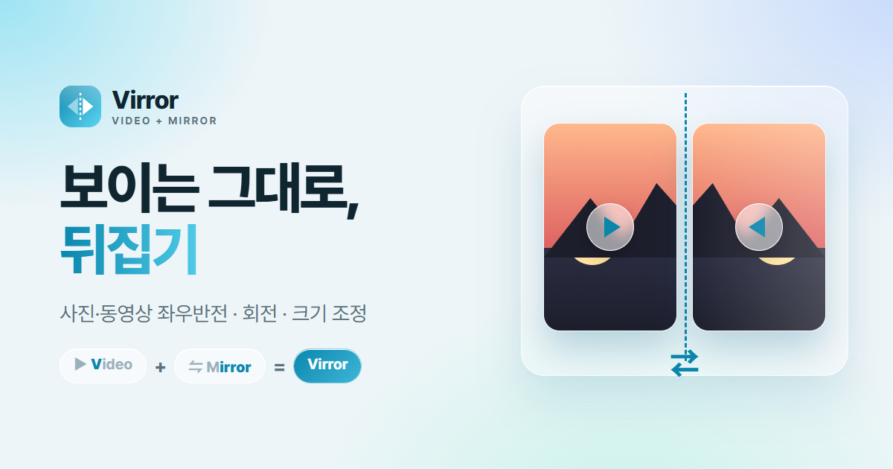

# Virror

**V**ideo + M**irror** — 사진·동영상을 좌우·상하로 반전하고, 90°씩 돌리고, 크기를 조정해서 바로 저장하는 웹 도구.

👉 **https://virror.vercel.app**



## 기능

- 사진(JPG·PNG·WEBP)과 동영상(MP4·MOV·WEBM) 좌우·상하 반전
- 90° 회전, 결과 크기 조정(비율 고정 / 원본·75%·50%·25%), 파일 이름 지정
- **업로드 없음** — 모든 처리가 브라우저 안에서 끝나요
- 동영상 빠른 변환: WebCodecs로 재생 없이 프레임 단위 디코드 → 반전 → H.264 인코드, 소리는 재인코딩 없이 그대로 복사
- 아이폰에서는 공유 창으로 사진 앨범에 바로 저장
- 다크 모드, 모바일 화면 지원

## 브라우저 지원

| 환경 | 동영상 변환 |
|---|---|
| Chrome · Edge · Safari 16.4+ | 빠른 변환 (MP4·MOV) |
| 그 외 / 구형 Safari / WEBM | 실시간 변환 (영상 길이만큼 걸림) |

## 구조

빌드 과정 없는 정적 사이트예요.

```
index.html            페이지 전체 (HTML·CSS·JS)
favicon.svg           탭 아이콘
apple-touch-icon.png  iOS 홈 화면 아이콘
og-image.png          링크 미리보기 이미지
```

외부 라이브러리(CDN): [mp4box.js](https://github.com/gpac/mp4box.js) (MP4 해석), [mp4-muxer](https://github.com/Vanilagy/mp4-muxer) (MP4 생성), [Pretendard](https://github.com/orioncactus/pretendard) (글꼴)

## 로컬에서 실행

```bash
python -m http.server 8000
# http://localhost:8000
```

## 배포

```bash
vercel deploy --prod
```
